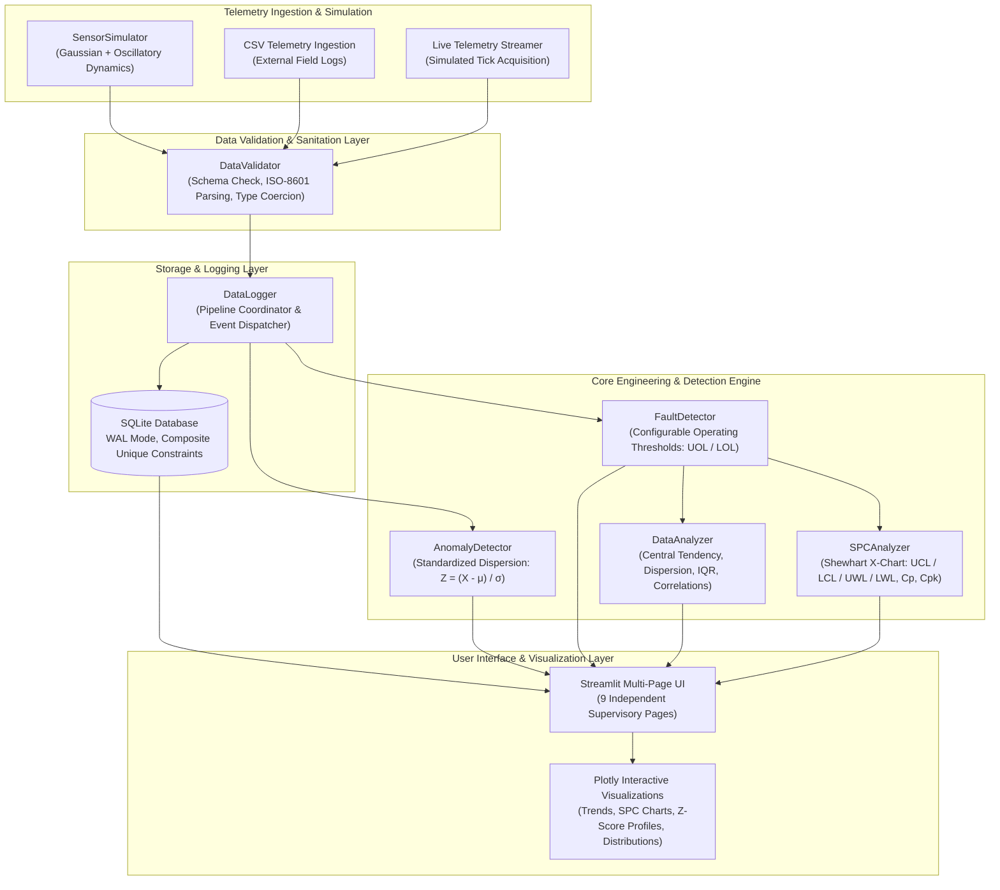
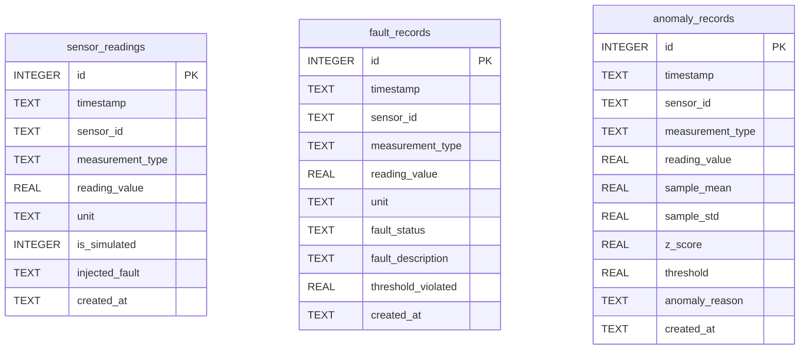

# System Architecture Document

## Industrial Sensor Monitoring & Predictive Fault Analysis System

### 1. Executive Architecture Overview

The **Industrial Sensor Monitoring & Predictive Fault Analysis System** is an instrumentation and industrial automation engineering prototype designed to model, monitor, and analyze continuous industrial plant telemetry. It simulates real-time supervisory control and data acquisition (SCADA) telemetry processing pipelines, featuring threshold-based fault identification, parametric statistical anomaly detection, Shewhart statistical process control (SPC), and persistent historical storage using SQLite.

---

### 2. High-Level System Architecture Diagram

---

### 3. Subsystem Breakdown

#### 3.1 Sensor Simulation Subsystem (`sensor_simulator.py`)
Generates multi-sensor time-series readings with realistic industrial signal physics:
- **Baseline Physics**: Continuous mean $\mu$ plus low-frequency sinusoidal plant oscillation and stationary Gaussian sensor noise:
  $$X(t) = \mu + A \sin\left(\frac{2\pi t}{T} + \phi\right) + \mathcal{N}(0, \sigma^2)$$
- **Configurable Fault Injections**:
  - `High Spike`: Thermal runaway / pressure surges.
  - `Low Drop`: Vessel leaks / pressure depletion.
  - `Sensor Drift`: Progressive calibration degradation over time.
  - `Missing Data`: Telemetry dropouts ($NaN$).
  - `Invalid Reading`: Physical constraint violations (ADC overflow / noise).

#### 3.2 Automatic Fault Detection Subsystem (`fault_detector.py`)
Deterministic threshold evaluation against engineering operating limits:
- **Status Classification**:
  - `NORMAL`: Reading satisfies $LOL \le X \le UOL$.
  - `HIGH_FAULT`: Reading satisfies $X > UOL$.
  - `LOW_FAULT`: Reading satisfies $X < LOL$.
  - `INVALID_READING`: Missing reading ($NaN$) or physical impossibility ($X < Min_{phys}$ or $X > Max_{phys}$).
- **System Health Synthesis**: Computes system-wide condition (`NORMAL`, `WARNING`, or `CRITICAL`) based on fault rates and severity.

#### 3.3 Statistical Anomaly Detection Subsystem (`anomaly_detector.py`)
Computes standardized univariate Z-scores per channel:
$$Z = \frac{X - \mu}{\sigma}$$
- Identifies points falling outside the configurable cutoff threshold ($|Z| > Z_{thresh}$, default $3.0$).
- Edge case handling: Safe division for zero standard deviation ($\sigma = 0$), missing values, and isolated samples.

#### 3.4 Statistical Process Control (SPC) Subsystem (`spc_analyzer.py`)
Implements classical Shewhart Individuals Control Charts ($X$-chart):
- **Center Line (CL)**: $\bar{X} = \frac{1}{n} \sum_{i=1}^{n} X_i$
- **Upper Control Limit (UCL)**: $\bar{X} + 3\sigma$
- **Lower Control Limit (LCL)**: $\bar{X} - 3\sigma$
- **Warning Limits (UWL / LWL)**: $\bar{X} \pm 2\sigma$
- **Rules Evaluated**:
  - *Rule 1*: Point beyond $3\sigma$ control limits ($> UCL$ or $< LCL$).
  - *Rule 2*: Run of 8 consecutive points on one side of the Center Line.
  - *Rule 3*: 2 out of 3 consecutive points in Warning Zone A ($> 2\sigma$).
- **Process Capability Evaluation**:
  $$C_p = \frac{USL - LSL}{6\sigma}, \quad C_{pk} = \min\left(\frac{USL - \mu}{3\sigma}, \frac{\mu - LSL}{3\sigma}\right)$$

---

### 4. Database Architecture & Entity-Relationship Model

- **Storage Engine**: SQLite 3 with Write-Ahead Logging (`PRAGMA journal_mode = WAL;`).
- **Integrity Constraints**: `UNIQUE(timestamp, sensor_id)` prevents accidental duplicates during batch re-runs.
- **Indexes**: Clustered B-tree indexes on `timestamp` and `sensor_id` for fast time-range slicing.
